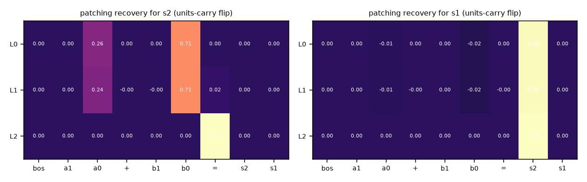
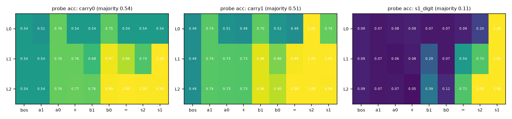

# arithmetic-transformer-interp

Mechanistic interpretability of a small transformer trained on 2-digit addition. The project combines three tools: **linear probes** (where a variable is decodable), **causal activation patching** (where it is actually *used*) and **TopK sparse autoencoders** (whether it gets its own feature). The question: *where and how does the model compute the carry?*

Everything runs on CPU in about 30 minutes:

```
pip install -e ".[dev]"
python -m interp.cli --seed 0 --out results
```

## Setup

```
pos:   0     1  2  3  4  5  6  7  8  9
tok: <bos>  a1 a0  +  b1 b0  = s2 s1 s0
```

- The model is a 2-layer, 128-d, 4-head pre-LN transformer, trained for 4k steps on all of 0–99 + 0–99 with held-out pairs.
- The answer is written **most-significant digit first**, so the model must resolve the units carry before it writes `s2`.
- Test accuracy is **100%** (exact match, and per digit).
- Residual "L0" is the embeddings, "L1" is after block 1 and "L2" is after block 2.
- Results are from **one seed** (seed 0). Treat them as a case study, not a population claim.

## Findings

### 1. The units carry is computed at the `b0` position, then moved to `=`



*Patching design:* each clean/corrupted pair has the same tens digits (with a tens column summing to 9) and units digits that flip the units carry. The units carry alone then decides `s2`. The corrupted prompt is run with the clean residual restored at one (layer, position), and the plot shows the normalised logit-difference recovery.

- To predict `s2` (read at `=`), restoring **`b0` at L0/L1 recovers 71%** and `a0` recovers 24–26%. **Nothing at `=` matters until L2**, where it recovers 100%.
- So block 1 combines `a0` and `b0` at the `b0` position (the first position where both units digits are visible under causal attention). Block 2 attention then **moves** the carry to `=`, where it is read out.
- Restoring `b0` alone does not reach 100% because the carry depends on both digits: patching one leaves the other corrupted.

### 2. Decodable ≠ used



Linear probes for the units carry:

| residual | at `b0` | at `=` | majority baseline |
|---|---|---|---|
| L0 (embeddings) | 0.753 | 0.544 | 0.544 |
| L1 | **0.973** | 0.885 | 0.544 |
| L2 | 0.992 | **0.9995** | 0.544 |

- At L1 the carry is **88.5% linearly decodable at `=`**, yet patching `=` at L1 recovers only **2%** of the behaviour. The model does not causally use that copy; the computation that matters is still at `b0`.
- This is the standard caveat about probes, showing up in a toy model: a probe finding information does not mean the model uses it.
- The tens carry (`a + b ≥ 100`) becomes decodable at `=` by L1 (0.988) and is exact (1.000) by L2.

### 3. The model also reads its own previous output (a teacher-forcing shortcut)

- For `s1` (predicted at position 7, whose input token is `s2`), almost all the recovery comes from **the `s2` token itself, even at L0 (0.99)**. Patching `a0` or `b0` does nothing.
- On this pair distribution (tens sum to 9) `s2` fully determines `s1`, and the model uses the digit it already emitted rather than recomputing the carry.
- This is correct behaviour, but it means `s1` circuits must be studied on prompts where `s2` does not determine `s1`.

### 4. SAEs: the hundreds carry gets near-monosemantic features; the units carry is distributed

- **Configuration:** TopK SAE, 256 latents (2× the model width), k = 8, trained on the residual at the three answer positions.

| | FVU | dead latents | CE loss recovered when spliced in |
|---|---|---|---|
| L1 | 0.0034 | 52% | 99.97% |
| L2 | 0.0045 | 14% | 100.0% |

- **Hundreds carry (`carry1`) at `=`:** at L2, five separate latents each have |r| ≥ 0.92 with it, and the best L1 latent has r = 0.87. That is a clean, mostly redundant, feature-level representation.
- **Units carry (`carry0`) at `=`:** no single latent exceeds |r| = 0.38 (0.30 at L1), even though a linear probe decodes it at 99.95%. The units carry is represented, but spread across several latents rather than given its own feature.
- **Dead latents:** 52% at L1 means the dictionary is oversized for this tiny task. The reconstruction is still essentially lossless.

## What I'd do next

- Run seeds 1–2 to check which of these structures are universal (`--seed 1`).
- Path patching (`b0` → `=` through specific heads) to name the heads that move the carry.
- Evaluate `s1` patching on prompts where the tens sum ≠ 9, to remove the teacher-forcing shortcut.

## Layout

| file | what |
|---|---|
| `src/interp/data.py` | fixed-length addition sequences, carry labels |
| `src/interp/model.py` | transformer with a hookable/patchable residual stream |
| `src/interp/probes.py` | logistic-regression probes on every (layer, position) |
| `src/interp/patching.py` | carry-flip pairs, logit-difference recovery grid |
| `src/interp/sae.py` | TopK SAE, FVU, dead fraction, spliced-in CE, feature–concept correlation |
| `results/seed0.json` | all numbers above |
